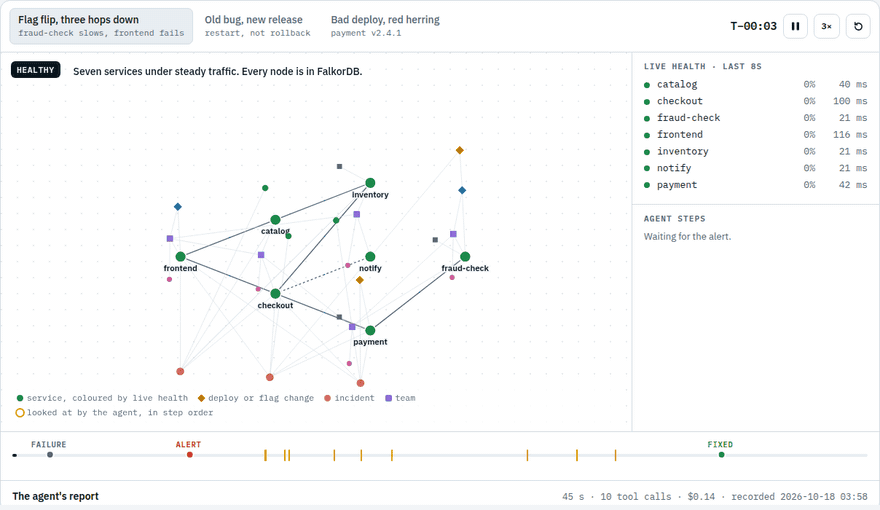
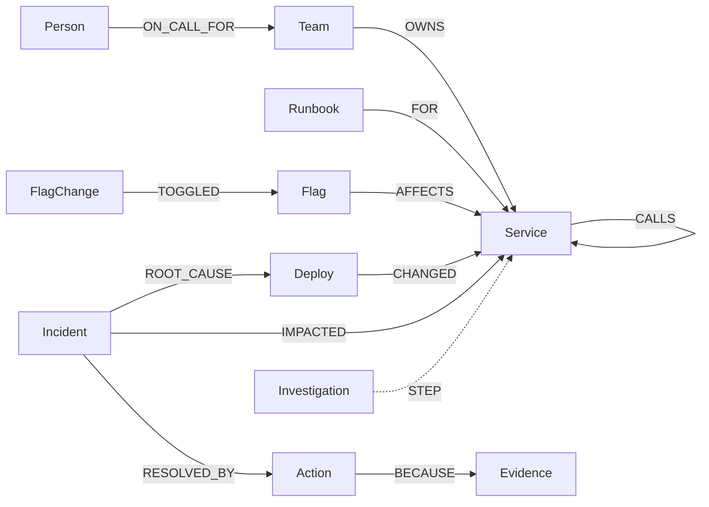
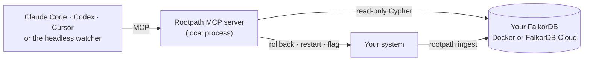

# Rootpath

**The alert is never where the bug is.**

Rootpath is an incident agent that reasons over a FalkorDB graph of your services, deploys, feature
flags, owners and past incidents. It follows a failure from the alert to where it starts, fixes it,
checks the fix, and remembers. It runs inside the agent you already use: Claude Code, Codex, Cursor
or any MCP host.

[Website](https://rootpath.iwhitebird.com) · [Demo video](__VIDEO_URL__)



## Quickstart

```bash
curl -fsSL https://rootpath.iwhitebird.com/install.sh | sh
rootpath init
```

`rootpath init` asks where your FalkorDB is (local Docker, FalkorDB Cloud or any URL), tests the
connection and connects your agents. Then, in Claude Code, inside your repository:

```
/rootpath:map
/rootpath:oncall checkout is throwing 500s
```

Or try the demo: seven services in Docker that you can break.

```bash
rootpath demo up
rootpath ui                # console at http://localhost:7100
rootpath chaos flag        # or bad-deploy, pool, deploy-noise, flag-collision, pool-after-deploy
rootpath watch --once      # the alert fires and a headless agent fixes it
```

## How it works



| The agent decides | From the graph | Tool |
|---|---|---|
| where the failure starts | `(alerting)-[:CALLS*0..6]->(d)`: the deepest unhealthy service whose dependencies are healthy | `rank_suspects` |
| which change matters | deploys via `CHANGED`, flag flips via `TOGGLED → Flag → AFFECTS`; anything off the failing path is ruled out | `rank_suspects` |
| what fixed it before | full-text index on incidents, then `ROOT_CAUSE` and `RESOLVED_BY` | `find_similar_incidents` |
| what a fix would break | upstream `CALLS` traversal | `get_blast_radius` |
| whether it may act | a matching dry-run `Action` from the last 15 minutes | safety hook |
| who to page | `OWNS`, `ON_CALL_FOR`, `ESCALATES_TO` | `notify_owner` |

Afterwards it writes the incident back with a `ROOT_CAUSE` edge to the exact change, and every tool
call as a `STEP` edge. The next agent, in a new session, finds it.

The graph is built three ways: `/rootpath:map` (Claude Code reads your compose files, manifests,
CODEOWNERS, runbooks and flags, and writes through validated tools that require evidence for every
dependency), `rootpath ingest --watch` (health, deploys and flag changes), and the agent itself.




## Graph data model

```
(:Team)-[:OWNS]->(:Service)-[:CALLS {declared, optional, observed}]->(:Service)
(:Person)-[:ON_CALL_FOR]->(:Team)-[:ESCALATES_TO]->(:Team)
(:Runbook)-[:FOR]->(:Service)
(:Team)-[:OWNS]->(:Flag)-[:AFFECTS]->(:Service)

(:Change:Deploy {version, prev_version, at})-[:CHANGED]->(:Service)
(:Change:FlagChange {flag, from, to, at})-[:TOGGLED]->(:Flag)
(:Person)-[:AUTHORED]->(:Change)      (:Deploy)-[:ROLLED_BACK]->(:Deploy)

(:Incident)-[:IMPACTED]->(:Service)
(:Incident)-[:ROOT_CAUSE]->(:Change | :Service)
(:Incident)-[:RESOLVED_BY]->(:Action)-[:BECAUSE]->(:Evidence)
(:Action)-[:REVERTS]->(:Change)

(:Investigation)-[:FOR]->(:Incident)
(:Investigation)-[:STEP {n, tool, at}]->(any node the agent looked at)
```

## Key Cypher

Every service that could be causing the alert:

```cypher
MATCH p = (s:Service {name: $s})-[:CALLS*0..6]->(d:Service)
RETURN d.name AS service, min(length(p)) AS hops
```

Flag changes that reach those services, though nothing was deployed there:

```cypher
MATCH (x:FlagChange)-[:TOGGLED]->(f:Flag)-[:AFFECTS]->(d:Service)
WHERE d.name IN $names AND x.at >= $since
RETURN d.name, x
```

Tie-breaking and the evidence path:

```cypher
CALL algo.betweenness({nodeLabels: ['Service'], relationshipTypes: ['CALLS']}) YIELD node, score

MATCH (a:Service {name: $a}), (b:Service {name: $b})
CALL algo.SPpaths({sourceNode: a, targetNode: b, relTypes: ['CALLS'], pathCount: 1}) YIELD path
```

Incident memory, a full-text index plus the graph:

```cypher
CALL db.idx.fulltext.queryNodes('Incident', $q) YIELD node, score RETURN node.id AS id, score

MATCH (i:Incident)-[:IMPACTED|ROOT_CAUSE]->(s:Service {name: $s}) RETURN DISTINCT i.id AS id

MATCH (i:Incident) WHERE i.id IN $ids AND i.status = 'resolved'
OPTIONAL MATCH (i)-[:ROOT_CAUSE]->(rc)
OPTIONAL MATCH (i)-[:RESOLVED_BY]->(a:Action)
RETURN i.id, collect(DISTINCT rc), collect(DISTINCT a)
```

Who to page:

```cypher
MATCH (t:Team)-[:OWNS]->(s:Service {name: $s})
OPTIONAL MATCH (p:Person)-[:ON_CALL_FOR]->(t)
OPTIONAL MATCH (t)-[:ESCALATES_TO]->(e:Team)
OPTIONAL MATCH (ep:Person)-[:ON_CALL_FOR]->(e)
RETURN t.name, p.handle, e.name, ep.handle
```

The safety hook, itself a query: no real action without a dry run.

```cypher
MATCH (a:Action {kind: $kind, target: $target, dry_run: true}) WHERE a.at >= $since RETURN count(a)
```

## Benchmark

The same agent (Claude Opus 5.5, headless) and the same remediation tools on six injected failures,
with the graph and without it. Baseline gets only health, logs and a flat list of changes. Every
scenario ran twice per mode, with and without tracing: 48 runs.

| | graph | baseline |
|---|---|---|
| clean fixes | **24/24** | 23/24 |
| service logs read before the fix | **24** | 63 |
| agent time | **1051 s** | 1362 s |
| cost | $3.30 | $3.35 |

With tracing, both agents find the cause; the graph gets there reading fewer logs. The one baseline
miss rolled back a healthy fraud-check release before turning the flag off. Two runs per cell is a
small sample. Every run is in [`bench/`](bench/).

## Safety

- Agent queries are read-only: `GRAPH.RO_QUERY` with a timeout and a row cap.
- Actions are dry runs by default. A Claude Code hook refuses a real action without a recent dry run,
  or during a change freeze, and fails closed.
- `rootpath watch --autonomy propose` makes the server refuse real actions.
- The headless agent gets only the Rootpath tools: no shell, file or web access.

## Agents

- **Claude Code:** `rootpath init` installs the plugin, or run `/plugin marketplace add IWhitebird/rootpath`
  and `/plugin install rootpath@rootpath`. Skills: `/rootpath:map`, `/rootpath:oncall`,
  `/rootpath:blast-radius`, `/rootpath:postmortem`.
- **Codex, Cursor, any MCP host:** `rootpath mcp` over stdio, or `http://localhost:7100/mcp` while
  `rootpath start` is running. The playbook for Codex is in [`AGENTS.md`](AGENTS.md).

## CLI

| Command | |
|---|---|
| `rootpath init` | connect a FalkorDB and your agents |
| `rootpath start`, `stop`, `status` | background server: console, ingest and MCP over HTTP |
| `rootpath mcp` | MCP server on stdio |
| `rootpath demo up`, `down`, `reset` | the demo stack |
| `rootpath chaos <scenario>` | break something |
| `rootpath watch` | alert watcher that starts the headless agent |
| `rootpath bench` | the benchmark above |

## Development

```bash
uv sync
uv run pytest tests/test_unit.py           # no Docker needed
uv run pytest tests/test_integration.py    # against the demo stack
uv run ruff check . && uv run ruff format --check .
cd web && npm ci && npm run build          # website and console
```

## AI assistance

Built with Claude Code as a pair programmer: it wrote much of the code under my direction. The
design, decisions, review and testing are mine.

## License

Apache-2.0. FalkorDB is licensed separately.
