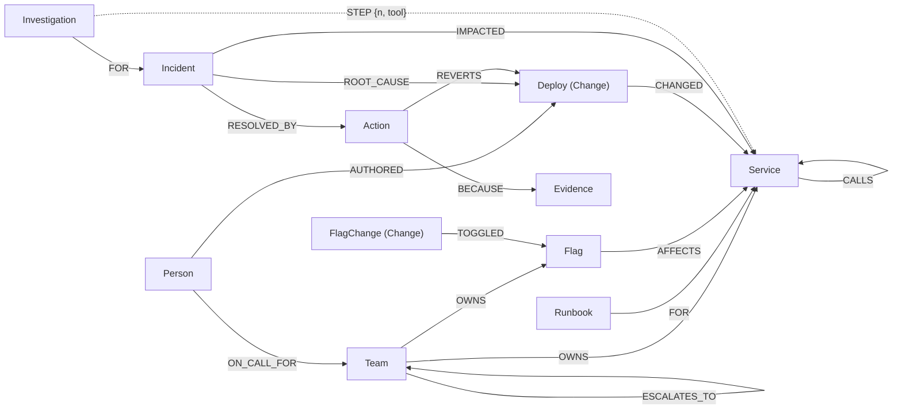
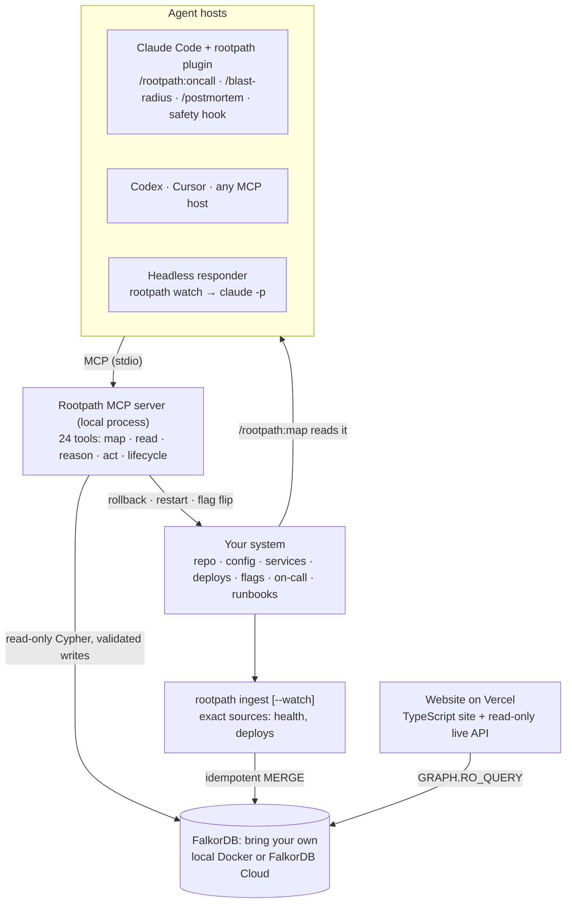

# Rootpath

**The alert is never where the bug is.** Rootpath is an incident agent that reasons over a
FalkorDB graph of your services, deploys, feature flags, owners and past incidents. It follows the
failure from the alert to where it starts, fixes it, checks the fix, and remembers. It runs inside
the coding agent you already use (a Claude Code plugin, or any MCP host such as Codex or Cursor), or
on its own when an alert fires.

**Live demo:** __LIVE_URL__ · **Demo video:** __VIDEO_URL__ ·
**Tracks:** Agents That Act on Connected Data · Agent Memory and Coordination
(Graph Hacks: Context for AI Agents, WeMakeDevs × FalkorDB, October 2026)


*A real recorded run: fraud-check gets slow after a feature flag is ramped, frontend alerts, and the
agent follows the graph three hops down. It rules out a deploy that happened at the same moment,
recalls the matching past incident, turns the flag off, verifies recovery, pages the owner and stores
the incident. [`docs/replay.mp4`](docs/replay.mp4) is the same clip as video.*

## Why a graph

When production breaks, the first half hour goes to working out **what changed, what's affected
and who owns it**. The answer depends on how things connect:

- the service that alerts is rarely the one that's broken;
- a deploy only matters if it sits on the failing path;
- a feature flag reaches services it was never deployed to;
- the right fix was usually already found the last time.

So Rootpath keeps all of it in one FalkorDB graph, and the agent's tools are graph queries.

## The graph



| Node | Key properties | Comes from |
|---|---|---|
| `Service` | name, tier, internet_facing, version, status, error_rate, p95_ms | service catalog (Compose labels); live health from each service's stats |
| `Team`, `Person` | name, channel / handle | team and on-call config |
| `Runbook` | id, title, steps | Markdown runbooks with front-matter |
| `Flag` | name, enabled, description | flag service metadata |
| `Change:Deploy`, `Change:FlagChange` | version, prev_version / flag, from, to, author, at | deploy and flag-flip events (the change log) |
| `Incident`, `Action`, `Evidence`, `Notification` | severity, status, mttr_min / kind, target, dry_run, reason | written by the agent's own tools |
| `Investigation` | agent, mode, steps, duration, cost, report | written on every tool call (`STEP` edges to what it looked at) |

`CALLS` edges carry `declared` (from config) and `observed` (call counts from live traffic). The full
schema, edge by edge, is in [Graph data model](#graph-data-model).

## Where the agent's decisions come from

Every decision the agent makes is a query or a graph algorithm over that model:

| The agent decides… | Graph work behind it | Tool |
|---|---|---|
| which services could be causing the alert | variable-length traversal `(alerting)-[:CALLS*0..6]->(d)` | `rank_suspects` |
| where the failure **starts** | the deepest unhealthy node whose own `CALLS` targets are healthy | `rank_suspects` |
| which changes matter | deploys via `CHANGED`, flag flips via `TOGGLED → Flag → AFFECTS` onto the candidate set | `rank_suspects`, `recent_changes` |
| which changes to ignore | changes whose targets are outside the candidate subgraph are listed as ruled out | `rank_suspects` |
| how to break ties between suspects | `algo.betweenness` over `CALLS` | `rank_suspects` |
| what evidence to show | `algo.SPpaths` from the alerting service to the suspect | `rank_suspects`, `trace_dependency_path` |
| what fixed this before | full-text index on incidents + `ROOT_CAUSE` / `RESOLVED_BY` edges; the suspect's runbooks via `FOR` | `find_similar_incidents`, `rank_suspects` |
| what a fix would break | upstream traversal `(u)-[:CALLS*1..6]->(service)` | `get_blast_radius`, `rollback_service` |
| what version to roll back to | `Deploy` history, skipping releases with an incoming `ROLLED_BACK` | `rollback_service` |
| who to page | `OWNS`, `ON_CALL_FOR`, `ESCALATES_TO` | `get_owner`, `notify_owner` |
| whether an action is allowed | a matching dry-run `Action` in the last 15 minutes must exist | safety hook |

Then it writes back: the incident with `ROOT_CAUSE` to the exact change, every `Action` with
`BECAUSE` evidence, and the `Investigation` steps. The next agent, in a new session, finds all of it.

One real run, as the agent called the tools:

```
ALERT frontend 50% errors
  ● rank_suspects(frontend)      frontend → checkout → payment → fraud-check
                                 fraud-check: slow, own dependencies healthy, flag fraud_model_v2 flipped 88s ago
                                 ruled out: notify v1.2.1 deploy (not on the failing path)
                                 context: runbook RB-FRAUD-01, past incident INC-027 (fixed by turning the flag off)
  ● get_logs(fraud-check)        latency 15ms → 1.9s right after the flip
  ● find_similar_incidents       INC-027: same flag, same symptom
  ● open_incident                INC-043
  ● set_feature_flag(dry_run)    plan: fraud_model_v2 true → false, affects fraud-check
  ● set_feature_flag             executed
  ● verify_recovery(frontend)    0% errors after 7s
  ● notify_owner(fraud-check)    paged ananya (#team-risk)
  ● resolve_incident             root cause → change chg-847f70af, stored in memory
done in 45s · 9 tool calls
```

## Architecture



There is no Rootpath server to run. The MCP server is a local process that Claude Code starts when the
plugin loads, the brain is the user's own agent, and all state lives in a FalkorDB the user brings.

**How the graph gets built**, three ways that write to the same model:

1. **`/rootpath:map`:** Claude Code reads the repository and config (compose files, Kubernetes
   manifests, CODEOWNERS, runbooks, flag definitions, git history) and writes through validated
   mapping tools: `upsert_service`, `add_dependency`, `set_team`, `add_runbook`, `register_flag`,
   `record_change`, with `map_overview` to see what is already there. They check names, require
   evidence for every dependency (file and key), refuse unknown services, `MERGE` idempotently, and
   tag everything `source: "claude-code"` so inferred structure stays reviewable.
2. **`rootpath ingest`** (`rootpath/ingest.py`): deterministic sources such as service config, live
   health, the deploy and flag log, teams and runbooks, written with batched, idempotent `UNWIND … MERGE`.
   `--watch` keeps health and changes fresh every few seconds; a full sync is about 12 round trips.
3. **The agent itself:** incidents, actions with their evidence, and every investigation step.

**Reasoning only reads:** every agent query goes through `GRAPH.RO_QUERY` with a timeout and a row
cap. Only these validated tools and deterministic code write.

## Quickstart

```bash
curl -fsSL https://raw.githubusercontent.com/IWhitebird/rootpath/main/web/public/install.sh | sh
rootpath init                              # where your graph lives, a connection test, your agents
```

`rootpath init` asks where your FalkorDB is (local Docker, which it can start for you; FalkorDB Cloud;
or any URL), tests the connection, and saves it to `~/.config/rootpath/config.toml`, readable only by
you. It then installs Rootpath into Claude Code (the plugin), Codex and Cursor, and offers the demo
system. Nothing goes into chat, and there is no Rootpath server to sign up for.

Then either map your own system, or try the demo:

```bash
# your system: in Claude Code, inside your repository
/rootpath:map
/rootpath:oncall checkout is throwing 500s

# the demo: 7 services in Docker that you can break on purpose
rootpath demo up
rootpath chaos flag            # or bad-deploy, pool, deploy-noise, flag-collision, pool-after-deploy
rootpath watch --once          # the alert fires and a headless agent investigates, fixes and verifies
```

**Background server:** `rootpath start` runs the console, the ingest loop and MCP over HTTP on
localhost in the background, like a local daemon. `rootpath status` shows it, the graph and service
health; `rootpath stop` ends it. Logs go to `~/.local/state/rootpath/`.

**Console** (`http://localhost:7100`, from `rootpath start` or `rootpath ui`): the graph with services in
call-depth columns, live health, the agent's numbered path as it reasons, its report, incident memory
and recent changes. With the demo running it adds **Break something**, a **graph / baseline** toolset
switch, **Run agent** and **Reset**. On your own system it shows your graph, and an empty graph tells you
to run `/rootpath:map`.

**From a clone** (development): `uv sync`, then prefix the commands with `uv run`
(`uv run rootpath demo up`, `uv run rootpath ui`). The demo needs Docker, and the headless agent needs
Claude Code, logged in.

| Scenario | What breaks | Correct fix | Trap |
|---|---|---|---|
| `bad-deploy` | payment v2.4.1 ships a tokenizer bug | roll back payment | catalog deploy at the same moment |
| `flag` | `fraud_model_v2` slows fraud-check, payment times out three hops below the alert | flag off | notify deploy at the same moment |
| `pool` | inventory's DB pool is exhausted, with no change at all | restart inventory | no recent change to blame |
| `deploy-noise` | the payment bug during a busy release hour | roll back payment | five healthy deploys, two on the failing path |
| `flag-collision` | the flag ramp, three minutes after a healthy fraud-check release | flag off | a release on the slow service |
| `pool-after-deploy` | pool exhaustion right after a healthy inventory release | restart inventory | a release on the failing service |

**Settings:** the config file from `rootpath init` is the single source (`rootpath config show`,
`rootpath config set falkordb_url …`). Environment variables override it (`FALKORDB_URL`,
`ONCALL_GRAPH`). FalkorDB Cloud URLs look like `falkor://<user>:<password>@<host>:<port>`
(`redis://` and `rediss://` for TLS work too).

## Use it from your agent

**Claude Code plugin:** the MCP server, `/rootpath:map`, `/rootpath:oncall`, `/rootpath:blast-radius`,
`/rootpath:postmortem`, and a safety hook.

```
/plugin marketplace add IWhitebird/rootpath
/plugin install rootpath@rootpath
/rootpath:map                                  # map your system into the graph
/rootpath:oncall checkout is throwing 500s     # investigate over it
```

`rootpath init` installs the plugin and the plugin reads the settings `init` saved. The plugin's own setup
dialog (FalkorDB URL, graph name) is only an override and can stay empty; its values are kept in the
system keychain, never in chat. Read tools are pre-approved. Real actions go through Claude Code's
permission prompt. The hook denies any real action that was not dry-run first, anything during a change
freeze, and fails closed if it cannot check.

**Codex CLI** (`~/.codex/config.toml`, written by `rootpath init`); the incident playbook is in [`AGENTS.md`](AGENTS.md):

```toml
[mcp_servers.rootpath]
command = "rootpath"
args = ["mcp"]
```

**Cursor, VS Code or any MCP host:** `rootpath mcp` over stdio, or, with `rootpath start` running,
`http://localhost:7100/mcp` over HTTP (`claude mcp add --transport http rootpath http://localhost:7100/mcp`).

**Headless:** `uv run rootpath watch` polls health. When a user-facing service fails twice in a row,
it launches `claude -p` with only the Rootpath tools (no shell, file or web tools) and stores the run
on the `Investigation` node. `--autonomy propose` makes the server refuse real actions.

## Live deployment

The website in `web/` is a Vite + TypeScript app on Vercel (project root directory `web/`). It is
static apart from one read-only serverless function, so nothing stays running:

- `web/src/site`: the public site: replays of recorded incidents, the benchmark, install steps, and a
  **Live** tab.
- `web/api/live.ts`: runs the console's graph, investigation and incident queries with `GRAPH.RO_QUERY`
  against the project's demo graph on FalkorDB Cloud (`FALKORDB_URL`, `FALKORDB_GRAPH` in Vercel's
  environment settings). When an incident is investigated on the demo stack, the Live tab shows it.
- `web/src/console`: the operator console, the same TypeScript code, served locally by `rootpath ui`.

**Rootpath Cloud (coming soon):** a hosted graph per workspace (one FalkorDB graph per tenant), a
remote MCP endpoint and webhooks for deploys and alerts, so a team can start without running a database.

## Does the graph matter?

`uv run rootpath bench` injects each failure into the live stack and runs the same headless agent
(Claude Opus 5.5) with the same remediation tools twice:

- **graph** gets the FalkorDB tools.
- **baseline** gets only health, logs and a flat change list.

Each scenario runs twice per mode, with full telemetry (stats say where errors originate, like
tracing) and with basic telemetry (error rate and latency only). That's 48 runs.

| telemetry | mode | clean fix¹ | logs read before the fix | agent time | cost |
|---|---|---|---|---|---|
| full | graph | **12/12** | **12** | **519 s** | $1.68 |
| full | baseline | 11/12 | 21 | 687 s | $1.55 |
| basic | graph | **12/12** | **12** | **532 s** | **$1.62** |
| basic | baseline | 12/12 | 42 | 675 s | $1.80 |

¹ The expected action on the expected target, and no other remediation action. Per-scenario tables
and every tool sequence: [`bench/RESULTS-full.md`](bench/RESULTS-full.md), [`bench/RESULTS-basic.md`](bench/RESULTS-basic.md).

- **With good telemetry, a frontier model usually finds the cause without a graph.** Baseline took
  the right action in all 24 runs.
- **The graph sends the agent to where the failure starts.** It read 62% fewer logs (24 vs 63); without
  tracing the gap is 12 vs 42.
- **That makes it faster at the same cost.** Agent time was 1051 s vs 1362 s, and total cost $3.30 vs $3.35,
  including the incident tracking, paging and memory that baseline doesn't do.
- **It avoids coincidences.** In one run, baseline rolled back a healthy release that landed just
  before the real cause. The graph agent made no wrong actions in 24 runs.
- An earlier version of `rank_suspects` did not hand over the suspect's runbook and history, and its
  agent once fell for the same trap. Its results are kept in [`bench/archive/`](bench/archive/).
- Two runs per cell is a small sample, so read these as directional.

## Graph data model

```
(:Team)-[:OWNS]->(:Service)-[:CALLS {declared, optional, observed}]->(:Service)
(:Person)-[:MEMBER_OF]->(:Team)   (:Person)-[:ON_CALL_FOR]->(:Team)-[:ESCALATES_TO]->(:Team)
(:Runbook)-[:FOR]->(:Service)
(:Team)-[:OWNS]->(:Flag)-[:AFFECTS]->(:Service)

(:Change:Deploy {version, prev_version, at})-[:CHANGED]->(:Service)
(:Change:FlagChange {flag, from, to, at})-[:TOGGLED]->(:Flag)
(:Person)-[:AUTHORED]->(:Change)      (:Deploy)-[:ROLLED_BACK]->(:Deploy)

(:Incident)-[:IMPACTED]->(:Service)
(:Incident)-[:ROOT_CAUSE]->(:Change | :Service)
(:Incident)-[:HAS_ACTION | RESOLVED_BY]->(:Action)-[:BECAUSE]->(:Evidence)
(:Action)-[:REVERTS]->(:Change)   (:Action)-[:ON]->(:Service | :Flag)   (:Action)-[:PRODUCED]->(:Change)
(:Incident)-[:NOTIFIED]->(:Notification)-[:TO]->(:Person)

(:Investigation)-[:FOR]->(:Incident)
(:Investigation)-[:STEP {n, tool, note, at}]->(any node the agent looked at)
```

## Key Cypher

Candidate suspects, everything downstream of the alerting service:

```cypher
MATCH p = (s:Service {name: $s})-[:CALLS*0..6]->(d:Service)
RETURN d.name AS service, min(length(p)) AS hops
```

Changes on the candidates, including flags that reach a service only through `AFFECTS`:

```cypher
MATCH (c:Deploy)-[:CHANGED]->(d:Service) WHERE d.name IN $names AND c.at >= $since RETURN d.name, c
MATCH (x:FlagChange)-[:TOGGLED]->(f:Flag)-[:AFFECTS]->(d:Service) WHERE d.name IN $names AND x.at >= $since RETURN d.name, x
```

Changes ruled out because they are not in the dependency graph of the symptom:

```cypher
MATCH (c:Change) WHERE c.at >= $since
OPTIONAL MATCH (c)-[:CHANGED]->(s:Service)
OPTIONAL MATCH (c)-[:TOGGLED]->(:Flag)-[:AFFECTS]->(fs:Service)
WITH c, coalesce(s.name, fs.name) AS target WHERE NOT target IN $names
RETURN c, target
```

Graph algorithms as agent tools:

```cypher
CALL algo.betweenness({nodeLabels: ['Service'], relationshipTypes: ['CALLS']}) YIELD node, score
MATCH (a:Service {name: $a}), (b:Service {name: $b})
CALL algo.SPpaths({sourceNode: a, targetNode: b, relTypes: ['CALLS'], pathCount: 1}) YIELD path
```

The suspect's history: past incidents caused by the service itself, or by a change that reached it:

```cypher
MATCH (s:Service {name: $s})
MATCH (i:Incident {status: 'resolved'})-[:ROOT_CAUSE]->(rc)
WHERE rc = s OR (rc)-[:CHANGED]->(s) OR (rc)-[:TOGGLED]->(:Flag)-[:AFFECTS]->(s)
OPTIONAL MATCH (i)-[:RESOLVED_BY]->(a:Action)
RETURN i.id, collect(DISTINCT rc), collect(DISTINCT {kind: a.kind, target: a.target})
```

Incident memory, a full-text index plus graph overlap:

```cypher
CALL db.idx.fulltext.createNodeIndex('Incident', 'title', 'symptom', 'summary')
CALL db.idx.fulltext.queryNodes('Incident', 'checkout|timeout|fraud') YIELD node, score
MATCH (i:Incident)-[:IMPACTED|ROOT_CAUSE]->(:Service {name: $s}) RETURN i.id
```

Ownership and escalation:

```cypher
MATCH (t:Team)-[:OWNS]->(s:Service {name: $s})
OPTIONAL MATCH (p:Person)-[:ON_CALL_FOR]->(t)
OPTIONAL MATCH (t)-[:ESCALATES_TO]->(e:Team)<-[:ON_CALL_FOR]-(ep:Person)
OPTIONAL MATCH (r:Runbook)-[:FOR]->(s)
RETURN t.name, p.handle, e.name, ep.handle, collect(r)
```

The safety hook, itself a graph query:

```cypher
MATCH (a:Action {kind: $kind, target: $target, dry_run: true}) WHERE a.at >= $since RETURN count(a)
```

## Safety

- Reasoning is read-only (`GRAPH.RO_QUERY` with a timeout and a row cap). The agent cannot write arbitrary Cypher.
- Actions default to `dry_run=true`, and the hook enforces "dry run before a real run" against the graph.
- `ONCALL_ALLOW_ACTIONS=0` (and `--autonomy propose`) makes the server refuse real actions.
- Change freeze: `touch .oncall/FREEZE` or `ONCALL_CHANGE_FREEZE=1`.
- The headless agent has no shell, file or web tools, only the Rootpath tools.
- Every action records who, why, what it reverted and which investigation it belongs to.

## Development

```bash
uv run pytest tests/test_unit.py          # unit tests, no Docker needed (run in CI)
uv run pytest tests/test_integration.py   # end-to-end tests against the live demo stack (~6 min)
uv run ruff check . && uv run ruff format --check .
cd web && npm ci && npm run build         # typecheck + build the site, console and API (run in CI)
uv run python scripts/build_binary.py     # the single rootpath binary for this OS, in dist/
```

Releases: pushing a `v*` tag builds the binaries for Linux x86_64, macOS arm64 and macOS x86_64 in CI
and attaches them to the GitHub release, which `install.sh` downloads (it falls back to
`uv tool install` where no binary fits).

The integration suite injects every scenario and checks that `rank_suspects` finds where the failure
starts, with red herrings scored low. It also takes the full fix loop through the real action tools and
checks the guarantees: rollback never redeploys a rolled-back release, actions can be disabled, agent
Cypher is read-only, and bad input returns an error instead of a crash. The mapping tools are tested on
a throwaway graph: idempotent writes, evidence required, unknown services refused, and the reasoning
tools see what was mapped.

```
rootpath/       tools.py (agent tools) · mcp_server.py · ingest.py · store.py · infra.py · responder.py
                guard.py · web.py · bench.py · record.py · seed.py · cli.py · config.py
web/            src/site (website) · src/console (operator console) · src/lib (shared graph renderer)
                api/ (Vercel read-only live API) · public/data (recorded incidents, benchmark)
demo/           docker-compose.yml · service/ (one configurable microservice) · teams · runbooks · flags
skills/ hooks/ .claude-plugin/   Claude Code plugin: skills (map, oncall, blast-radius, postmortem),
                safety hook, manifest with the FalkorDB setup dialog
prompts/        headless agent playbooks
bench/          benchmark results
tests/          unit, onboarding, background-server, path and integration tests
scripts/        build_binary.py (PyInstaller) · replay capture for the docs media
```

| Command | What it does |
|---|---|
| `rootpath init` | onboarding: graph location, connection test, connect Claude Code / Codex / Cursor |
| `rootpath config show / set KEY VALUE` | the saved settings (password masked) |
| `rootpath start / stop / status` | background server: console, ingest loop, MCP over HTTP |
| `rootpath serve` | the same server in the foreground |
| `rootpath health` | service health table |
| `rootpath demo up / down / reset [--soft]` | run, stop or reset the demo stack |
| `rootpath chaos <scenario>` | inject a failure |
| `rootpath ingest [--watch] [--interval S]` | sync the graph from its sources, once or continuously |
| `rootpath ui` | operator console on :7100, in the foreground |
| `rootpath mcp [--mode graph\|baseline]` | MCP server on stdio |
| `rootpath watch [--once] [--autonomy propose]` | alert watcher that launches the headless agent |
| `rootpath bench [--scenario ...] [--repeats N]` | graph vs baseline benchmark |
| `rootpath record <scenario>` | record an incident for the website replay |
| `rootpath call <tool> key=value ...` | call any agent tool directly |

## Related work

- **[woodpecker-mcp](https://github.com/sspcodeflix/woodpecker-mcp)** also keeps a service dependency graph
  in FalkorDB behind MCP tools. It is analysis-only: no deploy or flag correlation, no remediation or
  verification, no incident memory.
- **AWS DevOps Agent, Datadog Bits AI SRE, Dynatrace, Causely** use topology graphs inside their own
  platforms. Resolve.ai, Cleric and Traversal are AI SRE startups.

Rootpath is open and self-hosted. It acts and verifies, remembers, and runs inside the agent you already use.

## AI assistance disclosure

Built during the hackathon with Claude Code as a pair programmer. It wrote substantial parts of the
code and documentation under my direction. The architecture, the product decisions, the review, and
the testing against the running system are mine. At runtime the agent is Claude, through Claude Code
or any MCP host. No model is trained or fine-tuned.

## License

Apache-2.0. FalkorDB is licensed separately under SSPL.
