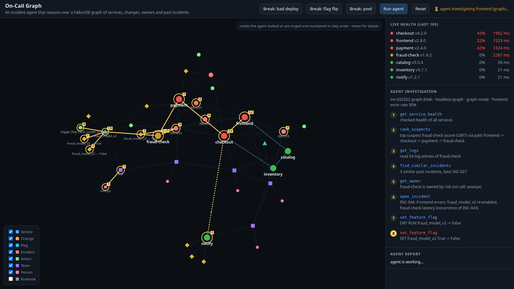

# On-Call Graph

**An incident agent that reasons over a FalkorDB graph, fixes the problem, and remembers.**
It plugs into the coding agent you already use (Claude Code, Codex, Cursor) over MCP, or runs
on its own when an alert fires.

> Graph Hacks: Context for AI Agents (WeMakeDevs × FalkorDB, Oct 2026)
> **Tracks:** 01 Agents That Act on Connected Data (primary) · 02 Agent Memory and Coordination



## The problem

When production breaks, the first 20–40 minutes of an incident go to working out **what changed,
what's affected and who owns it**. That means jumping between dashboards, logs, deploy history and
Slack. AI agents mostly don't fix this. They either grep every log (slow, expensive, easy to fool
with a coincidental deploy) or only *diagnose* without acting, verifying or learning.

The answer depends on **how things connect**:

- the service that alerts is rarely the one that's broken;
- a deploy only matters if it sits on the failing path;
- a feature flag affects services it is never deployed to;
- the right fix was usually already found the last time.

That is a graph problem.

## What it does

```
ALERT frontend 50% errors
  ● rank_suspects(frontend)      graph: frontend → checkout → payment → fraud-check
                                 fraud-check: slow, own deps healthy, flag fraud_model_v2 flipped 88s ago
                                 ruled out: notify v1.2.1 deploy (not on the failing path)
  ● get_logs(fraud-check)        latency 15ms → 1.9s right after the flip
  ● find_similar_incidents       INC-027: same flag, same symptom, fixed by turning it off
  ● open_incident                INC-043
  ● set_feature_flag(dry_run)    plan: fraud_model_v2 true → false, affects fraud-check
  ● set_feature_flag             executed
  ● verify_recovery(frontend)    0% errors after 7s ✓
  ● notify_owner(fraud-check)    paged ananya (#team-risk)
  ● resolve_incident             root cause → change chg-847f70af, stored in memory
done in 45s · 9 tool calls
```

1. **Locate:** multi-hop traversal from the alerting service through `CALLS` edges, combined with
   live health, recent `Deploy`/`FlagChange` nodes and `algo.betweenness`. The deepest unhealthy
   node on the path with a fresh change wins. Changes outside the dependency graph are explicitly
   ruled out.
2. **Confirm:** logs of the top suspect only, plus **incident memory**: a full-text and graph-overlap
   search over past `Incident` nodes, their `ROOT_CAUSE` and what `RESOLVED_BY` them.
3. **Act:** roll back, restart or flip a flag. Every action is dry-run first and recorded as
   `(:Action)-[:BECAUSE]->(:Evidence)`, linked to the change it reverts.
4. **Verify:** poll the user-facing service until it's healthy twice in a row.
5. **Remember:** the resolved incident, its root-cause change and the fix go back into the graph.
   The next similar alert is solved faster.
6. **Explain:** every tool call is a `STEP` of an `Investigation` node. The UI replays exactly which
   nodes the agent looked at, in order.

## Architecture

```
┌──────────────────────────── AGENT HOSTS (the brain) ─────────────────────────────┐
│ Claude Code + plugin      Codex CLI        Cursor / VS Code     Headless responder │
│ /oncall /blast-radius     config.toml      mcp.json             `oncall-graph watch`│
│ /postmortem + guard hook  + AGENTS.md                           → claude -p         │
└────────────┬─────────────────┬────────────────┬──────────────────────┬────────────┘
             └─────────────────┴──── MCP (stdio) ┴──────────────────────┘
┌──────────────────────────── oncall-graph MCP server ─────────────────────────────┐
│ READ        get_service_health · get_logs · get_blast_radius · recent_changes      │
│             get_owner · find_similar_incidents · explain_incident · query_graph    │
│ REASON      rank_suspects (traversal + betweenness) · trace_dependency_path (SPpaths)│
│ ACT         rollback_service · restart_service · set_feature_flag  (dry-run first)  │
│ LIFECYCLE   open_incident · verify_recovery · notify_owner · resolve_incident       │
└──────────┬────────────────────────────┬──────────────────────────────┬────────────┘
           │ Cypher (RO for reasoning)   │ ingest (idempotent MERGE)    │ docker compose
┌──────────▼───────────┐   ┌────────────┴─────────────┐   ┌────────────▼────────────┐
│ FalkorDB             │◄──│ compose labels + env      │   │ 7 microservices + load  │
│ services, calls,     │   │ live /_stats (observed    │   │ feature flags           │
│ teams, people, flags,│   │   calls, health)          │   │ change log (CI/CD+flags)│
│ deploys, incidents,  │   │ teams.json · runbooks     │   │ chaos scenarios         │
│ actions, evidence,   │   │ change log                │   └─────────────────────────┘
│ investigations       │   └───────────────────────────┘
└──────────▲───────────┘
           └── Web UI (localhost:7100): live graph + numbered agent path + report
```

## Quickstart (about 3 minutes)

Requirements: Docker, [uv](https://docs.astral.sh/uv/), and Claude Code (for the agent; any MCP host works for the tools).

```bash
git clone <this repo> oncall-graph && cd oncall-graph
uv sync
uv run oncall-graph demo up        # FalkorDB :6380 (browser :3005), 7 services, load generator, seeded history
uv run oncall-graph ui             # http://localhost:7100
```

Break something and let the agent fix it:

```bash
uv run oncall-graph chaos flag     # or: bad-deploy | pool
uv run oncall-graph watch --once   # alert fires → headless Claude Code investigates, fixes, verifies
```

You can also click **Break** and then **Run agent** in the UI and watch the path light up.
`uv run oncall-graph demo reset` brings everything back to a healthy baseline.

| Scenario | What happens | Correct fix | Red herring |
|---|---|---|---|
| `bad-deploy` | payment v2.4.1 ships a tokenizer bug → checkout and frontend 5xx | roll back payment | catalog deploy at the same moment |
| `flag` | `fraud_model_v2` makes fraud-check slow → payment times out 3 hops below the alert | flag off | notify deploy at the same moment |
| `pool` | inventory's DB pool is exhausted, with **no change at all** → checkout and catalog fail | restart inventory | none; recent-change heuristics alone fail here |

## Use it from your agent

**Claude Code (plugin):** MCP server, `/oncall-graph:oncall`, `/oncall-graph:blast-radius`, `/oncall-graph:postmortem`, plus the safety hook.

```bash
/plugin marketplace add <owner>/oncall-graph
/plugin install oncall-graph@oncall-graph
# or, from a clone:
claude --plugin-dir /path/to/oncall-graph
```

Then type `/oncall-graph:oncall checkout is throwing 500s`. Read tools are pre-approved. Real actions
go through Claude Code's permission prompt (human in the loop), and the guard hook denies any
real action that wasn't dry-run first, or anything at all during a change freeze (`touch .oncall/FREEZE`).

**Codex CLI** (`~/.codex/config.toml`); the playbook lives in [`AGENTS.md`](AGENTS.md):

```toml
[mcp_servers.oncall]
command = "uv"
args = ["run", "--quiet", "--directory", "/abs/path/to/oncall-graph", "oncall-graph", "mcp"]
[mcp_servers.oncall.env]
FALKORDB_URL = "redis://localhost:6380"
```

**Cursor / VS Code / any MCP host:** the same server, as a stdio command:
`uv run --directory /abs/path/to/oncall-graph oncall-graph mcp`.

**Headless / autonomous:** `uv run oncall-graph watch` polls health. When a user-facing service fails
twice in a row, it launches `claude -p` with only the oncall MCP tools (`--strict-mcp-config --tools ""`)
and stores the run (tool calls, tokens, cost, report) on the `Investigation` node.
Use `--autonomy propose` for dry-run-only recommendations.

## Does the graph matter? (benchmark)

`uv run oncall-graph bench` runs every scenario twice, with the same model and the same remediation
actions. The **graph** mode gets the FalkorDB reasoning tools. The **baseline** mode gets what a plain
observability stack gives you (health, logs, a flat change log).

See [`bench/RESULTS.md`](bench/RESULTS.md) for the latest numbers.

## Graph data model

```
(:Team)-[:OWNS]->(:Service)-[:CALLS {declared, optional, observed}]->(:Service)
(:Person)-[:MEMBER_OF]->(:Team)   (:Person)-[:ON_CALL_FOR]->(:Team)-[:ESCALATES_TO]->(:Team)
(:Runbook)-[:FOR]->(:Service)
(:Team)-[:OWNS]->(:Flag)-[:AFFECTS]->(:Service)

(:Change:Deploy {version, prev_version, at})-[:CHANGED]->(:Service)
(:Change:FlagChange {flag, from, to, at})-[:TOGGLED]->(:Flag)
(:Person)-[:AUTHORED]->(:Change)      (:Deploy)-[:ROLLED_BACK]->(:Deploy)

(:Incident)-[:IMPACTED]->(:Service)
(:Incident)-[:ROOT_CAUSE]->(:Change | :Service)
(:Incident)-[:HAS_ACTION | RESOLVED_BY]->(:Action)-[:BECAUSE]->(:Evidence)
(:Action)-[:REVERTS]->(:Change)   (:Action)-[:ON]->(:Service | :Flag)   (:Action)-[:PRODUCED]->(:Change)
(:Incident)-[:NOTIFIED]->(:Notification)-[:TO]->(:Person)

(:Investigation)-[:FOR]->(:Incident)
(:Investigation)-[:STEP {n, tool, note, at}]->(any node the agent looked at)
```

**Where the data comes from:** services, owners and declared calls come from the compose file's
labels and env. *Observed* calls and live health come from each service's `/_stats`. Teams and
on-call come from `demo/teams.json`, runbooks from Markdown front-matter, and deploys and flag flips
from the change log (the CI/CD + flag-service audit trail). Past incidents are seeded synthetic
history. All ingestion is idempotent `MERGE`. The agent's reasoning runs as read-only `GRAPH.RO_QUERY`
with a 2s timeout; only deterministic code writes.

## The Cypher the product depends on

Candidate suspects: everything downstream of the alerting service, with distance:

```cypher
MATCH p = (s:Service {name: $s})-[:CALLS*0..6]->(d:Service)
RETURN d.name AS service, min(length(p)) AS hops
```

Changes on those candidates, including flags that reach a service only through `AFFECTS`:

```cypher
MATCH (c:Deploy)-[:CHANGED]->(d:Service) WHERE d.name IN $names AND c.at >= $since RETURN d.name, c
MATCH (x:FlagChange)-[:TOGGLED]->(f:Flag)-[:AFFECTS]->(d:Service) WHERE d.name IN $names AND x.at >= $since RETURN d.name, x
```

Graph algorithms used as agent tools:

```cypher
CALL algo.betweenness({nodeLabels: ['Service'], relationshipTypes: ['CALLS']}) YIELD node, score
MATCH (a:Service {name: $a}), (b:Service {name: $b})
CALL algo.SPpaths({sourceNode: a, targetNode: b, relTypes: ['CALLS'], pathCount: 1}) YIELD path
```

Changes ruled out because they aren't in the dependency graph of the symptom:

```cypher
MATCH (c:Change) WHERE c.at >= $since
OPTIONAL MATCH (c)-[:CHANGED]->(s:Service)
OPTIONAL MATCH (c)-[:TOGGLED]->(:Flag)-[:AFFECTS]->(fs:Service)
WITH c, coalesce(s.name, fs.name) AS target WHERE NOT target IN $names
RETURN c, target
```

Blast radius (who is affected upstream) and ownership with escalation and runbooks:

```cypher
MATCH p = (u:Service)-[:CALLS*1..6]->(s:Service {name: $s})
WITH u, min(length(p)) AS hops MATCH (t:Team)-[:OWNS]->(u) RETURN u.name, hops, u.internet_facing, t.name

MATCH (t:Team)-[:OWNS]->(s:Service {name: $s})
OPTIONAL MATCH (p:Person)-[:ON_CALL_FOR]->(t)
OPTIONAL MATCH (t)-[:ESCALATES_TO]->(e:Team)<-[:ON_CALL_FOR]-(ep:Person)
OPTIONAL MATCH (r:Runbook)-[:FOR]->(s)
RETURN t.name, p.handle, e.name, ep.handle, collect(r)
```

Incident memory: a full-text index plus graph overlap, then root cause and fix:

```cypher
CALL db.idx.fulltext.createNodeIndex('Incident', 'title', 'symptom', 'summary')
CALL db.idx.fulltext.queryNodes('Incident', 'checkout|timeout|fraud') YIELD node, score
MATCH (i:Incident)-[:IMPACTED|ROOT_CAUSE]->(:Service {name: $s}) RETURN i.id
MATCH (i:Incident) WHERE i.id IN $ids
OPTIONAL MATCH (i)-[:ROOT_CAUSE]->(rc) OPTIONAL MATCH (i)-[:RESOLVED_BY]->(a:Action)
RETURN i, collect(rc), collect(a)
```

The safety guard (`oncall_graph/guard.py`) is itself a graph query: no real action unless a matching dry run exists.

```cypher
MATCH (a:Action {kind: $kind, target: $target, dry_run: true}) WHERE a.at >= $since RETURN count(a)
```

## Safety

- Reasoning is read-only (`GRAPH.RO_QUERY`, timeout, row cap). The agent can't write arbitrary Cypher.
- Actions default to `dry_run=true`, and the plugin hook enforces "dry run before real run" against the graph.
- `ONCALL_ALLOW_ACTIONS=0` forces every action to be a dry run, for read-only deployments.
- Change freeze: `touch .oncall/FREEZE` or `ONCALL_CHANGE_FREEZE=1`.
- The headless agent gets no shell, file or web tools, only the oncall MCP tools.
- Every action is attributable: who, why, what it reverted, which investigation.

## Related work

- **[woodpecker-mcp](https://github.com/sspcodeflix/woodpecker-mcp):** also stores a service dependency
  graph in FalkorDB and exposes topology, root-cause and blast-radius tools over MCP. It is analysis-only:
  no change correlation (deploys/flags), no remediation or verification, no incident memory.
- **AWS DevOps Agent, Datadog Bits AI SRE, Dynatrace Smartscape/Davis, Causely:** graph- or topology-based
  commercial AI SRE. They are closed and tied to their own platform.
- **Resolve.ai, Cleric, Traversal:** AI SRE startups.

On-Call Graph is open, self-hosted, uses FalkorDB as the reasoning substrate rather than as storage,
acts and verifies, remembers, and runs inside whichever agent you already use.

## Project layout

```
oncall_graph/   tools.py (agent tools) · mcp_server.py · ingest.py · seed.py · infra.py · responder.py
                bench.py · web.py · guard.py · store.py · cli.py
demo/           docker-compose.yml · service/ (one configurable microservice) · teams.json · runbooks/ · flags/
skills/         oncall · blast-radius · postmortem (Claude Code plugin skills)
hooks/          hooks.json (PreToolUse guard)
.claude-plugin/ plugin.json (MCP server inline) · marketplace.json
prompts/        headless agent playbooks
ui/             index.html (force-graph)
```

## AI assistance disclosure

Built during the hackathon with Claude Code (Claude Opus 5.5) as a pair programmer. It wrote
substantial parts of the code, the UI and this README under my direction. Architecture, scope and
product decisions, review, and testing against the running system were done by me. At runtime the
agent itself is Claude (via Claude Code headless or any MCP host). There is no model training or
fine-tuning anywhere in the project.

## License

Apache-2.0. FalkorDB itself is licensed under SSPL.
